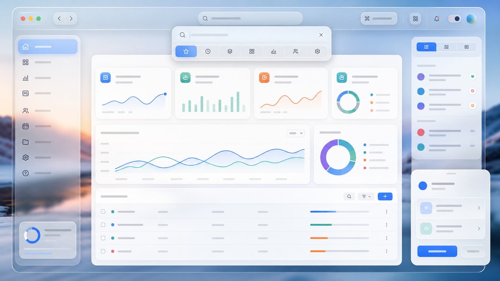

# Apple-Inspired Liquid Glass UI Skill

An open-source Codex skill for designing and implementing web interfaces inspired by Apple's Liquid Glass direction and Human Interface Guidelines.



This project helps AI coding agents create usable web app interfaces with clear hierarchy, restrained glass materials, responsive layout, accessible motion, and practical CSS implementation patterns.

## Quick Start

After installing the skill, ask Codex to use it on a real interface task:

```text
Use $apple-liquid-glass-ui to redesign this SaaS dashboard with Apple-inspired Liquid Glass UI. Keep the workflow efficient, readable, and accessible.
```

The skill is most useful for product interfaces, dashboards, app shells, navigation systems, toolbars, sheets, modals, and responsive web app layouts. It is not intended to generate Apple clones or decorative glassmorphism pages.

## What This Skill Does

- Guides AI agents to design Apple-inspired web app shells, dashboards, toolbars, tab bars, modals, sidebars, and controls.
- Translates Apple HIG and Liquid Glass principles into web-safe UI rules.
- Provides CSS patterns for progressive `backdrop-filter` glass effects, dark mode, contrast, reduced motion, and fallback behavior.
- Keeps glass effects on functional chrome instead of turning every content card into decoration.
- Encourages verification across mobile, desktop, accessibility settings, and realistic product states.

## Install

Copy the skill folder into your Codex skills directory:

```powershell
Copy-Item -Recurse .\apple-liquid-glass-ui "$env:USERPROFILE\.codex\skills\apple-liquid-glass-ui"
```

Then invoke it in Codex with:

```text
Use $apple-liquid-glass-ui to redesign this dashboard with Apple-inspired Liquid Glass UI.
```

## Repository Contents

- `apple-liquid-glass-ui/SKILL.md`: Trigger metadata and core workflow.
- `apple-liquid-glass-ui/references/apple-principles.md`: Condensed Apple HIG and Liquid Glass interpretation for web work.
- `apple-liquid-glass-ui/references/web-patterns.md`: CSS and component implementation patterns.
- `apple-liquid-glass-ui/agents/openai.yaml`: Codex UI metadata for the skill.
- `examples/prompts.md`: Example prompts for using and testing the skill.

## Boundaries

This project is Apple-inspired and is not affiliated with, endorsed by, or sponsored by Apple. It does not include Apple proprietary assets, logos, SF Symbols, product screenshots, or private application code.

## Design Philosophy

The skill favors product clarity over visual novelty:

- Functional chrome can use glass; dense content should stay crisp.
- Accessibility, contrast, and responsive behavior are part of the style.
- Web implementations should use progressive enhancement instead of assuming every browser supports the same blur and transparency behavior.
- AI-generated UI should be reviewed against real states: loading, empty, error, disabled, selected, focused, mobile, and desktop.

## Why It Exists

AI agents can produce attractive glassmorphism quickly, but they often overuse blur, weaken contrast, or ignore real product workflows. This skill gives agents a compact, reusable design standard so the result feels polished, usable, and maintainable.

## Security and Privacy

This repository is designed to contain only reusable public guidance. Please do not submit proprietary assets, private customer data, API keys, or confidential product code in issues or pull requests. See [SECURITY.md](SECURITY.md) for responsible reporting guidance.

## License

MIT
